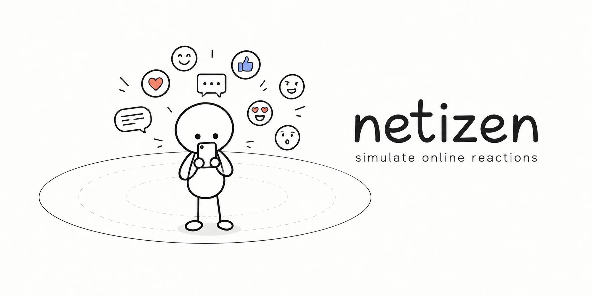

<div align="center">



### Simulate how Indonesian netizens react to a post, before it goes live

<a href="https://moddestlab.com/netizen/"></a>
<a href="https://docs.typesafe.ai"></a>
<a href="https://moddestlab.com"></a>


<a href="LICENSE"></a>
<a href="https://github.com/Seheta/netizen/stargazers"></a>
<a href="https://github.com/Seheta/netizen/commits/main"></a>

[How it works](#how-it-works) · [Running it](#running-it) · [Context, images, episodes](#context-images-and-episodes) · [Status](#status) · [Demo](https://moddestlab.com/netizen/)

</div>

Netizen simulates how Indonesian netizens react to a social media post or issue. Personas (Bekasi mothers, ojol drivers, students, buzzers, news accounts, and more) are judged by [Jev](https://docs.typesafe.ai) from TypeSafe: do they stop scrolling, what do they do, and where do they stand. The result is compared against real comments from real cases (Tapera, the 12% VAT, UKT tuition, free school meals, and others).

Demo: https://moddestlab.com/netizen/

## How it works

1. **Retrieve**: find the cases in `data/library` closest to the new post and show their real comment mix as an anchor.
2. **Audience**: Jev judges which personas and interest segments are in the post's first circle.
3. **Simulate** (`spike/rounds.py`): round 1, netizens see the post; round 2, followers see the influencers' takes. Read in three reach scenarios: niche, busy, viral.

The characters on the page are weighted representatives, not a sample of N individuals: each persona carries the share of the audience it stands for, so there is no "number of netizens" to tune.

## Running it

Needs `uv`. The CLI scripts read `TYPESAFE_API_KEY` from `.env`; the web page uses the key the visitor types, sent per request and never stored. Everything runs from this folder.

```bash
uv run spike/run_issue.py --text "your draft post" --platforms X/Twitter,TikTok   # report in the terminal
uv run spike/server.py                                                            # web UI at http://localhost:8798
uv run spike/backtest_youtube.py train                                            # test against real YouTube comments
```

The web page opens with five **sample runs** (fictional accounts, real issues from August to October 2026, recorded real runs in `web/samples/`, made by `spike/record_samples.py`) that can be viewed without a key. Deploy with `bash deploy.sh` (static page plus a stdlib Python server behind nginx).

## Context, images and episodes

A post can be given **issue context**: two to four sentences on what the public already knows and feels about the issue when the post appears. Without it, personas judge from the post text and general knowledge only. In the backtest, context cut the gap to real comments for the boycott case from 0.38 to 0.22 and for Holywings from 0.42 to 0.11 (`uv run spike/backtest_youtube.py c10_boikot b2_holywings [--no-context]`; the contexts live in `spike/cases.json`).

A post can be text or an image (png/jpg, judged directly by Jev). On the web, a post can be followed by the next **episode** (a clarification, a defence, new content): personas are told what the account posted before and how netizens reacted, and the timeline can rewind or branch.

`spike/personas.json`, `interest_segments.json`, `variants.json` and `influencers.json` are the world; `data/library/youtube_labels` holds the labeled real cases. Run results are saved to `spike/results/` (not committed).

## Status

A spike. Backtest on 16 YouTube cases: mean sentiment-mix gap around 0.15 on both the train and test splits, worse on cases whose context cannot be read from the video title alone; the context field is the answer to that.

## License

[MIT](LICENSE) © 2026 Moddest Lab.
